<div align="center">

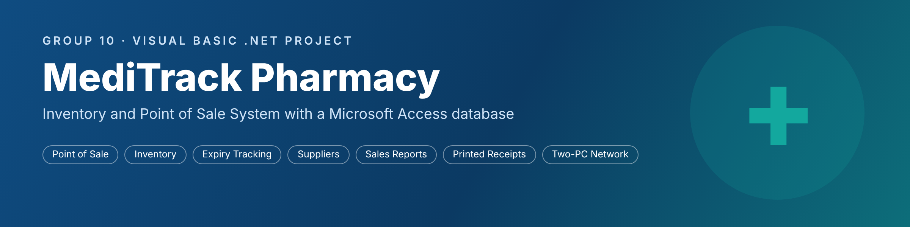

**A complete pharmacy inventory and point-of-sale system for Windows,**
**built in Visual Basic .NET with a Microsoft Access database.**

### [🎬 Watch the 3-minute demo video](https://drive.google.com/file/d/1Lp0OqdeBP_BIPK2jo_2ccFs9G0Y2vGhA/view?usp=sharing)

[What it does](#-what-meditrack-does) ·
[Make it yours](#-make-it-your-own) ·
[Tour of the screens](#-tour-of-the-screens) ·
[How it works](#%EF%B8%8F-how-it-works) ·
[Run it](#-how-to-run-it) ·
[Two computers](#-using-it-on-two-computers) ·
[Group 10](#-group-10)

</div>

---

## 💊 What MediTrack does

MediTrack is **ready-made software for pharmacies**. One program runs the daily work of a pharmacy, and every
pharmacy that uses it sets it up under **its own name, logo, colours and contact details**. Everything is saved
permanently in a Microsoft Access database, so nothing is lost when the program is closed.

| | Feature | What it means for the pharmacy |
|:-:|---|---|
| 🛒 | **Counter (point of sale)** | Search a drug by name or batch, add it to the sale, take Cash, Mobile Money or Card, give change and print a receipt. Stock goes down automatically. |
| 📦 | **Inventory** | Add drugs, receive new stock, edit prices and reorder levels. Colours show expired, low and soon-to-expire stock. |
| ⏰ | **Expiry tracker** | Every drug sorted by the nearest expiry date, with a filter. Expired stock can be written off and is recorded as a loss. |
| 🚚 | **Suppliers** | A contact list of suppliers with the drugs each one supplies. |
| 📊 | **Admin dashboard** | Sales today and this month, items sold, stock value, losses, low stock, expiring drugs, a 7-day sales chart, best sellers and a reorder list. |
| 🧾 | **Sales records** | Every receipt by date, customer or receipt number. Reprint a receipt, void / refund a sale, print an end-of-day summary, export to Excel. |
| 📜 | **History log** | An audit trail of every action: sales, stock in, stock out, returns, write-offs, edits and sign-ins, with the user and time. |
| 👥 | **Users and settings** | Staff and admin accounts, pharmacy details printed on receipts, the admin access code and database backups. |
| 🎨 | **Your own brand** | Each business shows its own name, logo, theme colour, phone numbers and email on every screen, receipt and report. |
| 🔑 | **Easy, safe sign-in** | Every password box has a **Show password** tick, so typing mistakes are easy to spot. |
| 🖧 | **Two computers, one database** | A counter PC and an admin PC share the same database over Wi-Fi (no internet needed). Changes show on the other PC within 3 seconds. |

### Who uses what

| Role | Signs in with | Can open |
|---|---|---|
| 👩‍⚕️ **Staff** (cashier, pharmacist) | Username and password | Counter, Inventory, Expiry Tracker |
| 👨‍💼 **Admin** (owner, manager) | Username and password, **or** the admin access code | Everything, including the Dashboard, Suppliers, History Log, Sales Records and Users and Settings |

Staff can sell and receive stock, but **only an admin** can change a price, reduce stock, delete a drug,
write off expired stock, void a sale or manage users.

---

## 🎨 Make it your own

MediTrack is not built for one pharmacy only. It is a product that can be **set up for any pharmacy**:
the owner types in the business details once, and the whole program carries that brand.

| You can change | Where it appears |
|---|---|
| **Business name** | Window titles, the header, the sign-in window, receipts and the sales summary |
| **Logo** (PNG or JPG) | The header, the sign-in window, the top of every receipt and the sales summary |
| **Theme colour** | The header, the sign-in panel, table headings and section titles |
| **Phone numbers** – as many as you need | Receipts (two numbers per line) and the sales summary |
| **Email and address** | Receipts and the sales summary |
| **Receipt note** | The thank-you line at the bottom of every receipt |

All of this is set in **First-Time Setup** and can be changed at any time in **Users and Settings**.
It is stored in the database, so **every computer** that shares the database shows the same branding at once.
The words *"Powered by MediTrack"* stay small on the sign-in window, receipts and reports.

**Example – the same software set up for "GoodLife Pharmacy" with its own logo and a green theme:**

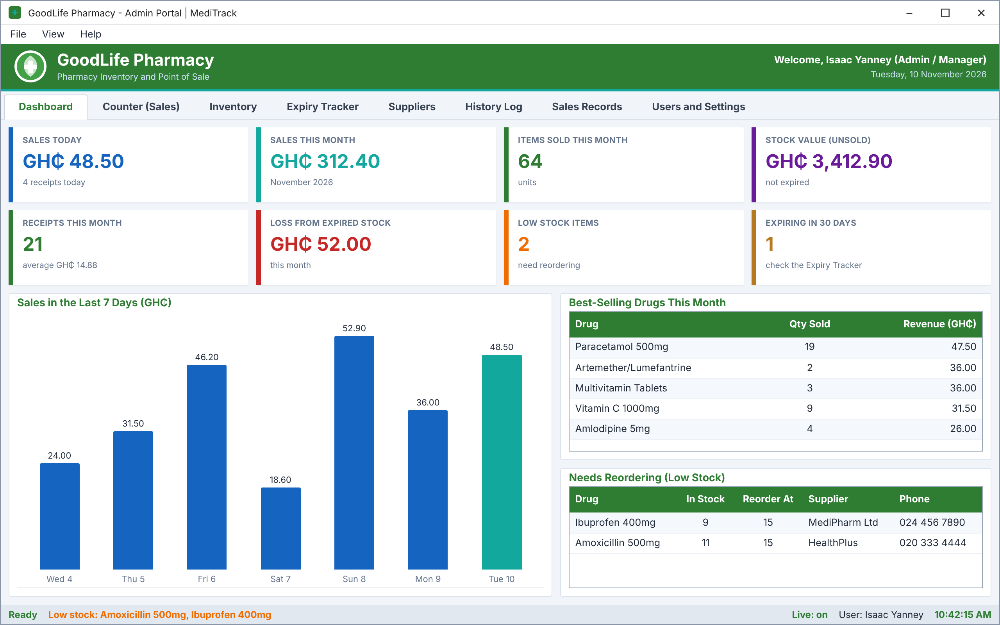

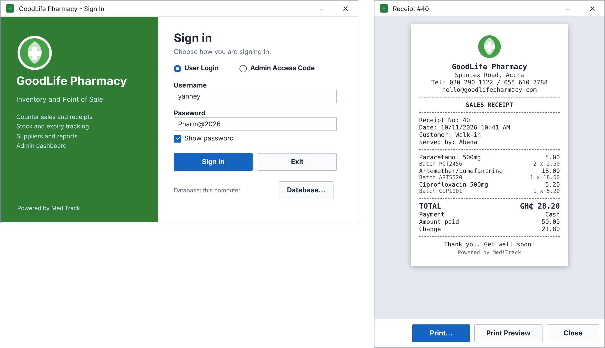

---

## 📸 Tour of the screens

### 1. First-Time Setup

The very first time MediTrack runs, it creates the database and opens **First-Time Setup**.
The owner enters:

- the **pharmacy name, address and phone numbers** (one or more, printed on every receipt),
- the **administrator account** (full name, username, password),
- the **admin access code** for quick admin sign-in (tick **Show password and code** to check what you typed),
- optionally the business **logo** and **theme colour**,
- and can tick **sample data** to start with ready-made drugs, suppliers and sales for training or a demo.

There are **no built-in passwords**. Every account is created by the pharmacy itself, and
passwords must be at least 6 characters.

<div align="center">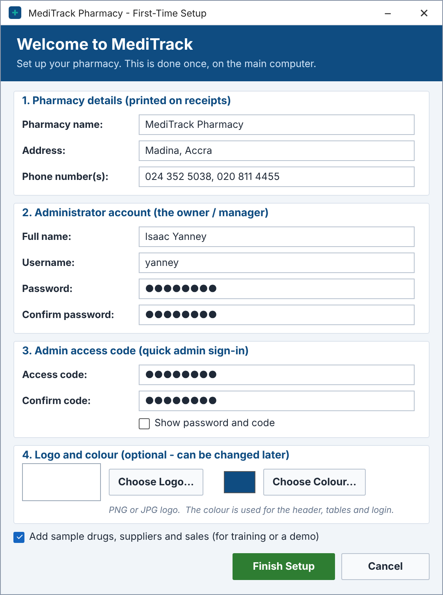</div>

### 2. Signing in

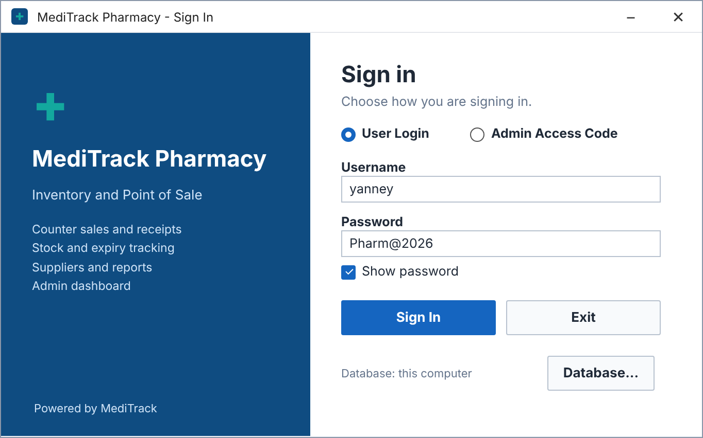

- **User Login** – username and password of a staff or admin account. Tick **Show password** to see what you typed.
- **Admin Access Code** – one code that opens the full admin portal.
- After **5 wrong attempts** the Sign In button locks for 30 seconds.
- **Database...** chooses where the database is: on this computer, or shared on another computer.
- After signing in, MediTrack shows a **stock alert** if any drugs are expired, expiring within 30 days, out of stock or low.

### 3. Admin Dashboard

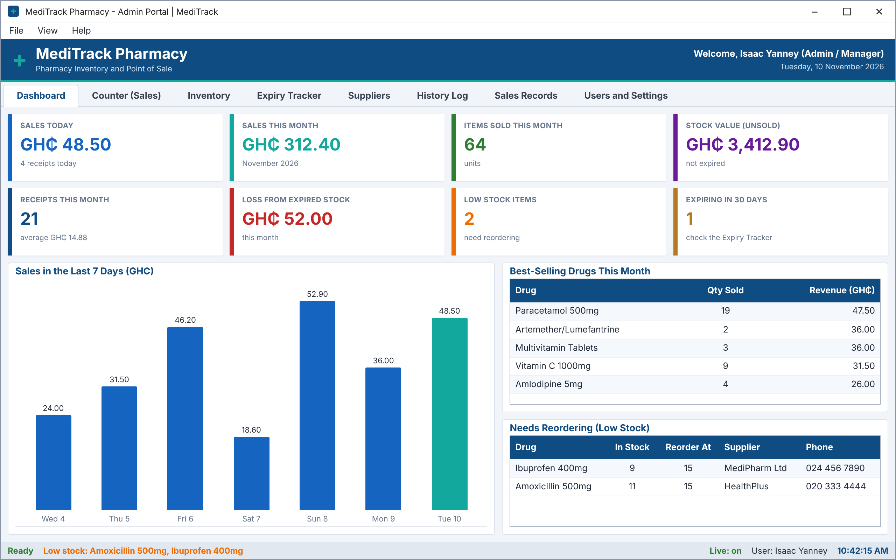

Eight coloured cards give the pharmacy's health at a glance: **sales today, sales this month,
items sold, stock value, receipts, loss from expired stock, low-stock items and drugs expiring in 30 days**.
Below them are the **sales of the last 7 days** as a bar chart, the **best-selling drugs** this month and a
**Needs Reordering** list with each supplier's phone number, ready for a call.

### 4. Counter (Sales)

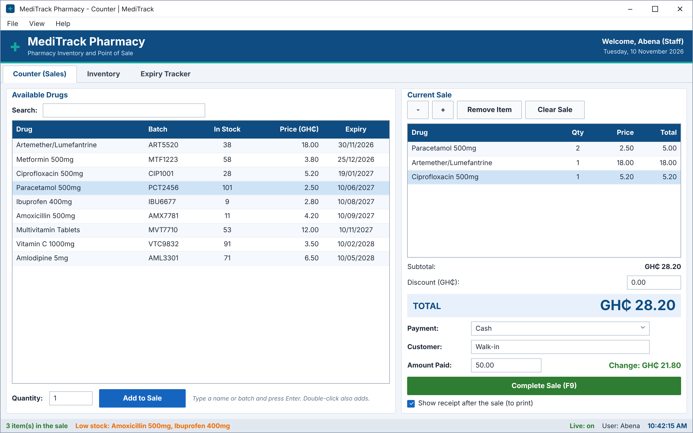

1. **Search** a drug by name or batch number and press **Enter** (works with a barcode scanner), or double-click it.
   The batch that expires **first** is listed first, and expired drugs are never shown for sale.
2. Change quantities with **+** and **–**, remove a line or clear the sale.
3. Enter an optional **discount**, choose **Cash, Mobile Money or Card** and the customer's name.
4. For cash, type the amount received – the **change** is worked out instantly.
   **A cash sale is refused if the money given is less than the total.**
5. Press **Complete Sale (F9)**. The stock goes down, the sale is saved and the receipt opens.

### 5. Printable receipt

Each sale produces a receipt sized for an **80 mm receipt printer** (it also prints on A4).
It shows the business **logo, name, address, all its phone numbers and email**, the receipt number, date,
customer, cashier, every item with its **batch number**, discount, total, payment method, amount paid,
change and the business's thank-you note.

Buttons: **Print...** (choose a printer), **Print Preview** and **Close**.
Any old receipt can be reprinted from **Sales Records**. A voided receipt prints with
**"VOIDED – NOT VALID"** on it.

<div align="center">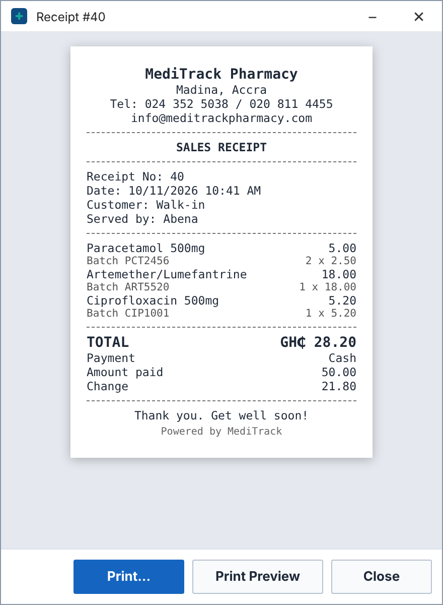</div>

### 6. Inventory

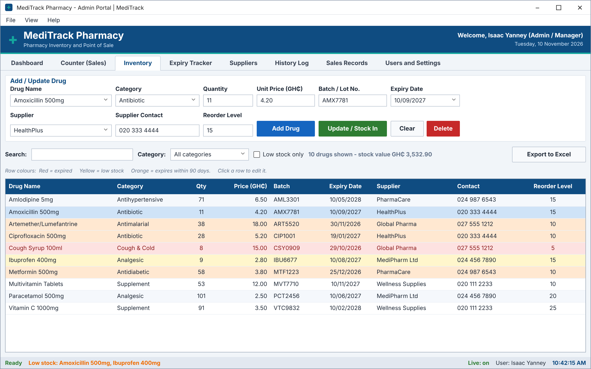

- **Add Drug** with its category, quantity, price, batch, expiry date, supplier and reorder level.
- **Update / Stock In** – click a row, type the new total, and MediTrack records the difference as *Stock In* or *Stock Out*.
- **Search**, filter by **category** or show **low stock only**; the count and value of what is shown appear on the right.
- Row colours: 🟥 **red** = expired · 🟨 **yellow** = low stock · 🟧 **orange** = expires within 90 days.
- **Export to Excel** saves the table as a CSV file.

### 7. Expiry Tracker

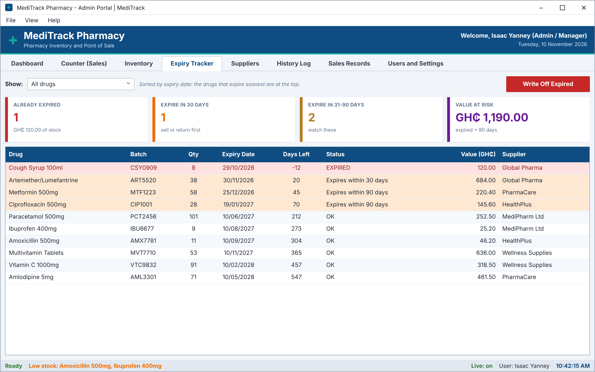

All drugs **sorted by the nearest expiry date**, with the days left and a status. Filter by
*Expired*, *within 30 days*, *within 90 days* or *more than 90 days*. The cards show how many are expired,
how many expire soon and the **money at risk**. **Write Off Expired** removes expired stock and records
the loss, which then appears on the dashboard.

### 8. Suppliers

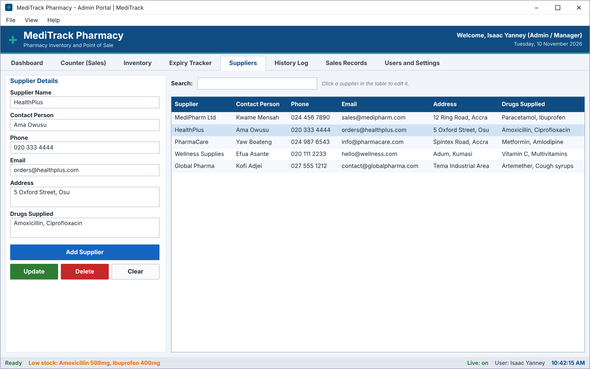

Add, update, delete and search suppliers: contact person, phone, email, address and the drugs they supply.
When a supplier is renamed, every drug from that supplier is updated too. Suppliers appear in the
drop-down list on the Inventory tab.

### 9. History Log

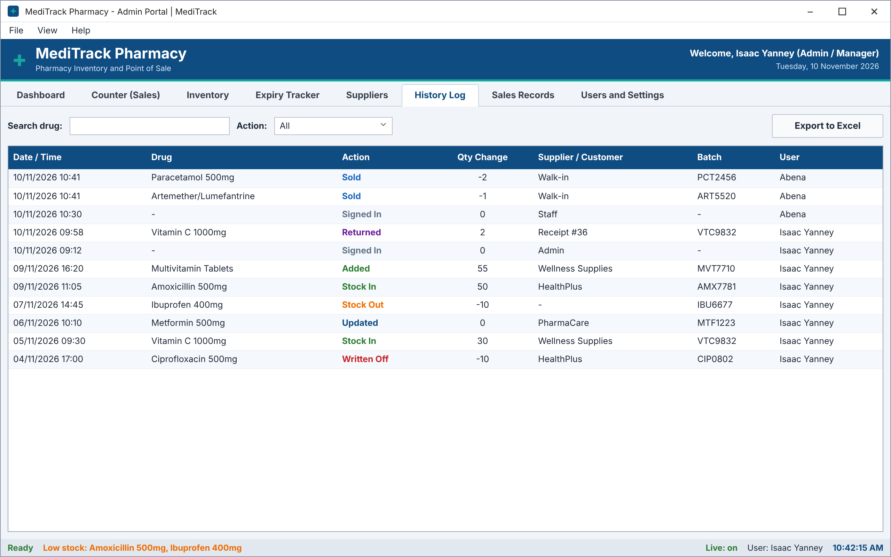

Every change is written down with the **date, drug, action, quantity, supplier or customer, batch and user**:
*Added, Stock In, Stock Out, Sold, Returned, Updated, Deleted, Written Off* and *Signed In*.
Search by drug, filter by action and export to Excel.

### 10. Sales Records

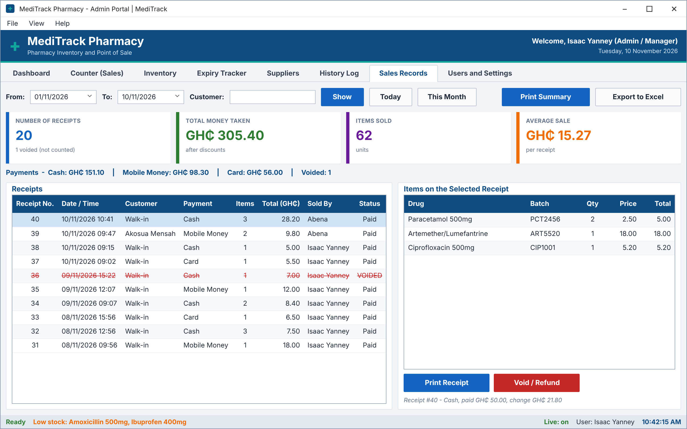

- Pick a **date range** (or *Today* / *This Month*) and search by **customer name or receipt number**.
- Cards show the **number of receipts, money taken, items sold and average sale**, plus a
  **Cash / Mobile Money / Card** breakdown.
- Click a receipt to see its items, then **Print Receipt** or **Void / Refund**.
- **Void / Refund** asks for a reason, puts the items back into stock and writes *Returned* in the history.
  The receipt stays in the list, struck through and marked **VOIDED**, and no longer counts in any total.
- **Print Summary** prints an A4 report for the chosen dates: net sales, discounts, payment methods,
  voided receipts, the top 10 drugs, write-offs and stock value, with signature lines.

### 11. Users and Settings

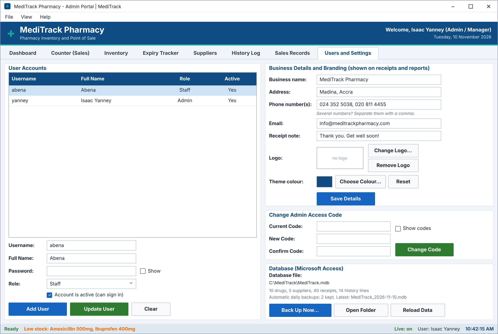

- **User accounts**: add staff or admin users, reset a password, or switch an account off.
  The last active admin can never be switched off, so the pharmacy cannot lock itself out.
- **Business details and branding**: name, address, phone numbers, email, receipt note, **logo** and **theme colour**.
  Changes show straight away on every screen, receipt and report, on every computer.
- **Change the admin access code** (tick **Show codes** to check them). The password box for users has a **Show** tick too.
- **Database**: where the file is, how many records it holds, **Back Up Now**, **Open Folder** and **Reload Data**.
  A backup copy is also made **automatically every day** (the newest 14 are kept).
- Every user can change their own password from **File → Change My Password**.

---

## ⚙️ How it works

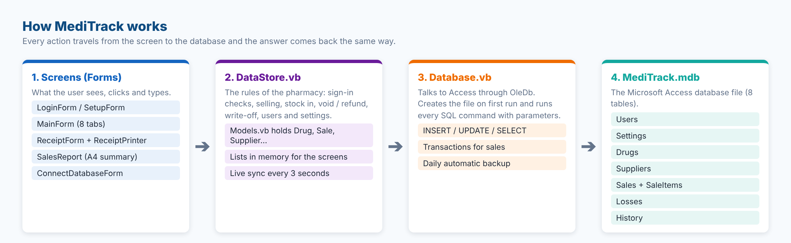

| Layer | File(s) | Job |
|---|---|---|
| **Screens** | `LoginForm`, `SetupForm`, `MainForm`, `ReceiptForm`, `ConnectDatabaseForm`, `ChangePasswordForm` | Windows Forms the user works with. Each button calls a method in `DataStore`. |
| **Printing** | `ReceiptPrinter.vb`, `SalesReport.vb` | Draw the 80 mm receipt and the A4 sales summary with `PrintDocument`. |
| **Branding** | `Branding.vb` | The business name, logo, theme colour and phone numbers used by every screen, receipt and report. |
| **Business rules** | `DataStore.vb`, `Models.vb` | Sign-in checks, selling, stock changes, voids, write-offs, users and settings. `Models.vb` defines `Drug`, `Supplier`, `Sale`, `SaleItem`, `HistoryEntry`, `LossRecord` and `AppUser`. |
| **Database access** | `Database.vb` | Finds or creates the Access file, opens it with **OleDb**, runs SQL with parameters and makes backups. |

### What happens when a sale is completed

1. `MainForm` checks the cart, the payment method and that the cash covers the total.
2. `DataStore.RecordSale` opens **one database transaction**.
3. It saves the receipt in **Sales**, each line in **SaleItems**, lowers the stock in **Drugs**
   (only if enough is still in stock) and writes a **Sold** line in **History**.
4. If any step fails, **everything is cancelled**, so stock and money always agree.
5. A new *DataVersion* stamp is saved in **Settings**. Every open MediTrack window checks this stamp
   every 3 seconds and reloads when it changes – that is how the admin dashboard updates live.
6. The receipt window opens, ready to print.

### The database (`MediTrack.mdb` / `.accdb`)

| Table | What it stores |
|---|---|
| **Users** | Username, password hash, full name, role (Staff / Admin), active or not |
| **Settings** | Business name, address, phone numbers, email, receipt note, logo (picture stored as text), theme colour, admin code hash, live-sync stamp |
| **Drugs** | Name, category, quantity, unit price, batch, expiry date, supplier, contact, reorder level |
| **Suppliers** | Name, contact person, phone, email, address, drugs supplied |
| **Sales** | Receipt number, date, customer, sold by, total, amount paid, discount, payment method, voided, void reason |
| **SaleItems** | The drugs on each receipt: drug, batch, quantity, unit price |
| **Losses** | Expired stock written off: date, drug, batch, quantity, value, reason |
| **History** | Every action: date, drug, action, quantity change, supplier / customer, batch, user |

The tables are created by the program on the first run. The file can also be opened in Microsoft Access.

### Security

- 🔒 Passwords and the admin code are stored as **SHA-256 hashes**, never as plain text.
- 🔒 No default or demo passwords; minimum length of 6 characters.
- 🔒 Passwords are hidden while typing; the **Show password** ticks are off until the user ticks them.
- 🔒 Sign-in locks for 30 seconds after 5 wrong attempts.
- 🔒 Staff cannot change prices, reduce stock, delete drugs, void sales or see reports.
- 🔒 All SQL uses **parameters**, which protects the database against SQL injection.
- 🔒 Every action is recorded in the History Log with the user's name.

---

## 🚀 How to run it

> [!NOTE]
> Requirements: **Windows 10 or 11** and **Visual Studio 2019 or 2022** with *.NET desktop development*
> (.NET Framework 4.8). The project builds as **32-bit (x86)** so it can use the Access engine that comes with Windows.

1. **Download** the project from GitHub (**Code → Download ZIP**).
   Before unzipping, right-click the ZIP → **Properties** → tick **Unblock** → **OK**.
2. **Open** `MediTrack.sln` in Visual Studio.
3. **Run** with **F5**. On the first run the database is created and **First-Time Setup** opens.

### Run it without Visual Studio

1. In Visual Studio change **Debug** to **Release** in the toolbar, then **Build → Rebuild Solution**.
2. Copy everything from `MediTrack\bin\Release\` to a folder such as **`C:\MediTrack`**.
3. Double-click **`MediTrack.exe`**. The database (`MediTrack.mdb` or `.accdb`) and the `Backups`
   folder are created next to it. Right-click the exe → **Send to → Desktop (create shortcut)**.

> [!TIP]
> To start again from First-Time Setup, close MediTrack and delete the `MediTrack.mdb` / `.accdb` file next to `MediTrack.exe`.

### Keyboard shortcuts

| Keys | Action |
|---|---|
| **F2** | New sale (jumps to the counter search box) |
| **Enter** in the search box | Add the first matching drug |
| **F9** | Complete the sale |
| **Ctrl + 1 … 8** | Open a tab |
| **Ctrl + L** | Log out |

---

## 🖧 Using it on two computers

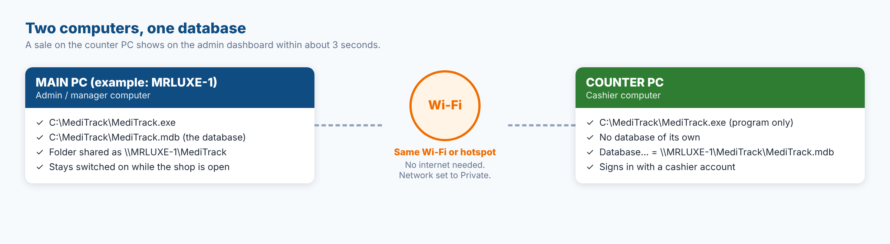

The **main PC** keeps the database in a shared folder. The **counter PC** runs the same program and
points to that database with the **Database...** button on the sign-in window. Both PCs only need to be on
the same Wi-Fi or phone hotspot – **no internet is needed**.

📘 **Step-by-step guide with screenshots: [TWO_COMPUTER_SETUP.md](TWO_COMPUTER_SETUP.md)**

---

## 🗂️ Project files

```
Group10-MediTrack/
├── MediTrack.sln                 Visual Studio solution
├── README.md                     This file
├── TWO_COMPUTER_SETUP.md         Network setup guide
├── Group_10.md                   Group members and index numbers
├── docs/screenshots/             Pictures used in this README
└── MediTrack/
    ├── MediTrack.vbproj          Project file (.NET Framework 4.8, x86)
    ├── LoginForm.vb              Sign in, database location, opens First-Time Setup
    ├── SetupForm.vb              First-Time Setup
    ├── MainForm.vb               The 8 tabs: dashboard, counter, inventory, expiry, ...
    ├── ReceiptForm.vb            Receipt window (print / preview)
    ├── ReceiptPrinter.vb         Draws the receipt
    ├── SalesReport.vb            Draws the A4 sales summary
    ├── ChangePasswordForm.vb     Change my password
    ├── Branding.vb               Business name, logo, colour, phone numbers
    ├── ConnectDatabaseForm.vb    Database on this PC or on another PC
    ├── DataStore.vb              Business rules and the in-memory lists
    ├── Database.vb               Access / OleDb connection and SQL helpers
    ├── Models.vb                 Drug, Supplier, Sale, SaleItem, ... classes
    └── *.Designer.vb             Screen layouts made in the Visual Studio designer
```

---

## 🛠️ Troubleshooting

| Problem | Fix |
|---|---|
| *"The Access database file could not be created"* | Make sure the platform is **x86** (it is set in the project). If it still fails, install the free **Microsoft Access Database Engine 2016 Redistributable (32-bit)**. |
| Designer shows an error or *Build failed* with no errors | The ZIP was blocked by Windows. Close Visual Studio, right-click the ZIP → Properties → **Unblock**, unzip again. |
| First-Time Setup appears again | The program cannot find its database. Copy `MediTrack.mdb` next to `MediTrack.exe`, or use **Database...** to point to it. |
| A counter PC cannot open the shared database | Follow [TWO_COMPUTER_SETUP.md](TWO_COMPUTER_SETUP.md), section *Problems and fixes*. |

---

## 👥 Group 10

| No. | Index Number | Name |
|:-:|:-:|---|
| 1 | 10319508 | Nkansah Obed |
| 2 | 10329576 | Yankey Emmanuel Kweku |
| 3 | 10330726 | Comforter Tetteh |
| 4 | 10326626 | Isaac Yanney |
| 5 | 10316776 | Stephen Aborgah |
| 6 | 10324481 | Dennis Ampofo Baah |

🎬 **Demo video (3 minutes):** [Watch on Google Drive](https://drive.google.com/file/d/1Lp0OqdeBP_BIPK2jo_2ccFs9G0Y2vGhA/view?usp=sharing)

<div align="center">

**MediTrack Pharmacy** · Visual Basic .NET · Windows Forms · Microsoft Access

</div>
