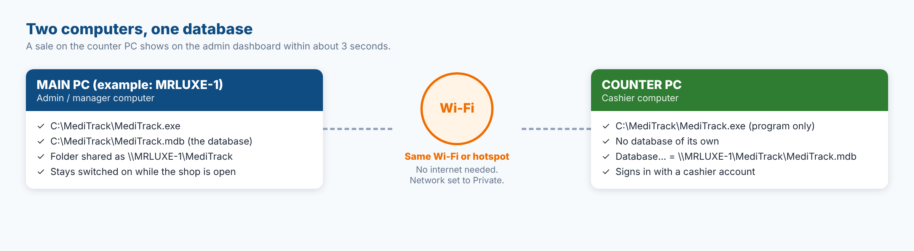
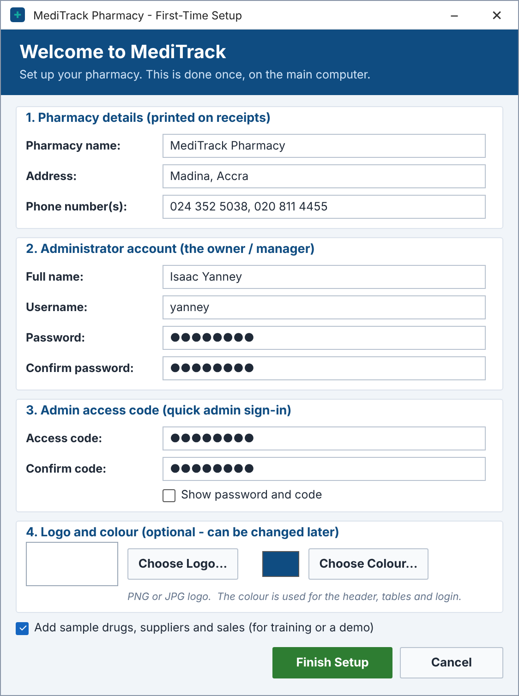
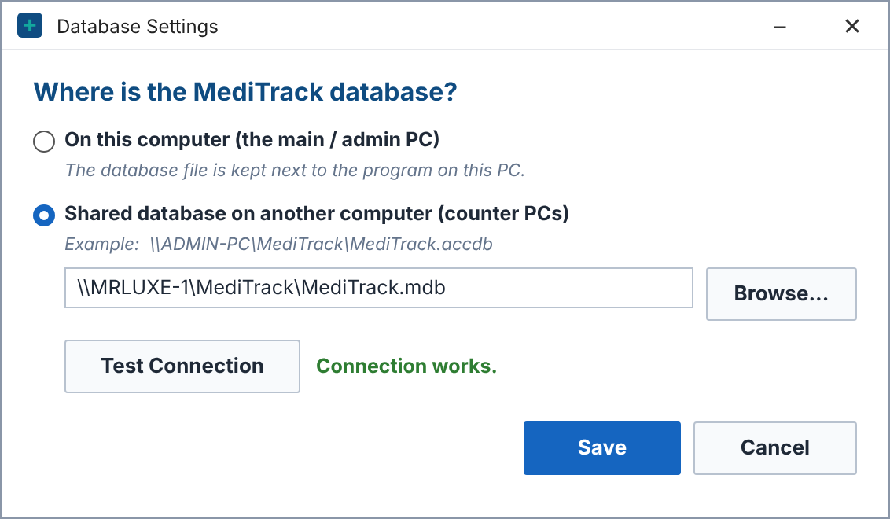
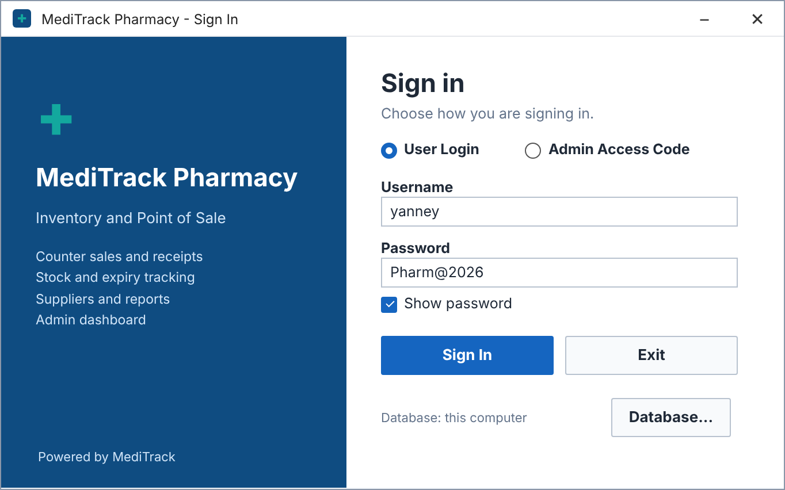

<div align="center">

# 🖧 Running MediTrack on Two Computers

**One database, shared over Wi-Fi or a phone hotspot. No internet needed.**

</div>



| Computer | Job | What it holds |
|---|---|---|
| 🟦 **Main PC** | Admin / manager computer | The program **and the database** (`MediTrack.mdb` or `.accdb`) in a shared folder |
| 🟩 **Counter PC** | Cashier computer | **Only the program.** It opens the database on the main PC through the network |

A sale made on the counter PC appears on the main PC's dashboard, inventory and sales records within
about **3 seconds**, and the other way round.

> [!IMPORTANT]
> Both computers must be connected to the **same Wi-Fi router or phone hotspot**, and the main PC must stay
> **switched on** while the counter is working. Mobile data can be off – the PCs talk to each other directly.

**Contents:** [1 Build](#part-1--build-the-program-once) ·
[2 Main PC](#part-2--set-up-the-main-pc) ·
[3 Counter PC](#part-3--set-up-the-counter-pc) ·
[4 Test](#part-4--test-it) ·
[Problems and fixes](#-problems-and-fixes) ·
[Daily use](#-daily-use)

---

## Part 1 – Build the program once

*On the computer that has Visual Studio.*

1. Open `MediTrack.sln`.
2. In the toolbar change **Debug** to **Release**
   (or **Build → Configuration Manager → Active solution configuration → Release**).
3. **Build → Rebuild Solution**. Wait for *Rebuild All: 1 succeeded*.
4. Right-click the **MediTrack** project in Solution Explorer → **Open Folder in File Explorer** → open **bin → Release**.
   These files are the whole program:

   | File | Needed on |
   |---|---|
   | `MediTrack.exe` | both PCs |
   | `MediTrack.exe.config` | both PCs |
   | `MediTrack.pdb` | optional |

---

## Part 2 – Set up the main PC

### Step 1 · Install the program and create the database

1. Create the folder **`C:\MediTrack`** and copy the files from `bin\Release` into it.
2. Double-click **`C:\MediTrack\MediTrack.exe`**. MediTrack creates the database in `C:\MediTrack` and opens
   **First-Time Setup**: enter the pharmacy details, create the administrator account and the admin access code.
3. Sign in as the administrator → **Users and Settings** → add an account for each cashier (role **Staff**).
   Here you can also set the business **logo, theme colour, phone numbers and email** – the counter PC will show them too.
4. Close MediTrack.



### Step 2 · Create a sharing login on the main PC

The counter PC must log in to the main PC to open the shared folder. The most reliable way is a small
**Windows account just for sharing**. It works whether the main PC uses a PIN, a Microsoft account or no password at all.

1. Right-click **Start** → **Terminal (Admin)** (or *Command Prompt* → *Run as administrator*) → **Yes**.
2. Type this and press **Enter** (choose your own password and write it down):

   ```
   net user meditrack YourPassword123 /add
   ```

3. It must say **The command completed successfully.**

> [!TIP]
> You can use your normal Windows account instead. If you sign in to the main PC with an **email** (Microsoft account),
> the counter PC must use **that email** and the **Microsoft account password – not the PIN**. If you only ever use a PIN,
> the dedicated `meditrack` account above is easier.

### Step 3 · Share the folder

1. Right-click **`C:\MediTrack`** → **Properties** → **Sharing** tab → **Advanced Sharing...**
2. Tick **Share this folder**. Set the **Share name** to **`MediTrack`**.
3. Click **Permissions** → **Add...** → type **`meditrack`** → **OK** → tick **Full Control** → **OK** → **OK**.
4. Open the **Security** tab → **Edit...** → **Add...** → type **`meditrack`** → **OK** → tick **Full control** → **OK** → **Close**.

> [!NOTE]
> **Full Control** is required. Access writes a small lock file (`.ldb` / `.laccdb`) next to the database
> whenever it is open. Without write permission the counter PC cannot save sales.

### Step 4 · Allow sharing on the network

1. **Settings → Network & internet → Wi-Fi →** click your connected network (or hotspot) → **Network profile type → Private network**.
2. **Settings → Network & internet → Advanced network settings → Advanced sharing settings**:

   | Section | Setting | Set to |
   |---|---|---|
   | Private networks | Network discovery | **On** |
   | Private networks | File and printer sharing | **On** |
   | All networks | Password protected sharing | **On** (the counter PC logs in with the `meditrack` account) |

### Step 5 · Find the main PC's name and keep it awake

1. **Start → Settings → System → About** → note the **Device name** (for example **`MRLUXE-1`**).
2. **Settings → System → Power** → set **Sleep** to **Never** while the pharmacy is open.

---

## Part 3 – Set up the counter PC

### Step 1 · Copy the program only

Create **`C:\MediTrack`** and copy **only** `MediTrack.exe` and `MediTrack.exe.config` into it.

> [!WARNING]
> **Do not copy `MediTrack.mdb` / `.accdb` to the counter PC.** If the counter PC has its own copy it works on
> a separate database, and its sales never reach the main PC. A sign that this has happened: the sign-in window shows a
> different pharmacy name, or *Database: C:\Users\...* instead of *\\\\MAIN-PC-NAME\\MediTrack\\...*

### Step 2 · Set the network to Private

Same as the main PC: **Settings → Network & internet → Wi-Fi →** your network → **Private network**.

### Step 3 · Log in to the main PC once

1. Open **File Explorer**, click the address bar, type **`\\MRLUXE-1\MediTrack`** (use the main PC's real name) and press **Enter**.
2. A **Windows Security – Enter network credentials** box appears. Type:

   | Field | Value |
   |---|---|
   | User name | **`MRLUXE-1\meditrack`** (main PC name, a back-slash, then the account) |
   | Password | the password from Part 2, Step 2 |

3. Tick **Remember my credentials** → **OK**.
4. You should now see **`MediTrack.mdb`** (or `.accdb`) in the folder.

### Step 4 · Point MediTrack to the shared database

1. Start **`C:\MediTrack\MediTrack.exe`**.
   - If **First-Time Setup** opens, click **Cancel**, then **Yes** (*"Is this a counter computer...?"*). Database Settings opens.
   - Otherwise click **Database...** on the sign-in window.
2. Choose **Shared database on another computer (counter PCs)** → **Browse...**
3. In the Browse window's address bar type **`\\MRLUXE-1\MediTrack`** → select **`MediTrack.mdb`** → **Open**.
4. Click **Test Connection** – it must say **Connection works.** – then **Save**.



5. The sign-in window now shows *Database: \\\\MRLUXE-1\\MediTrack\\MediTrack.mdb* and the main PC's business name, logo and colour.
   Sign in with a **cashier account**.



---

## Part 4 – Test it

1. **Main PC:** sign in as admin and open the **Dashboard**.
2. **Counter PC:** make a sale on the **Counter** tab.
3. Within about **3 seconds** the main PC's *Sales Today* card, inventory and sales records change.
   The status bar on both PCs shows **Live: on**.

---

## 🧰 Problems and fixes

| What you see | Why | Fix |
|---|---|---|
| **"The username or password is incorrect"** | Wrong user name format, or Windows remembered an old wrong login | Type the user name as **`MAIN-PC-NAME\meditrack`**. Then on the counter PC open **Credential Manager → Windows Credentials**, remove every entry for the main PC and try again. For a Microsoft account use the **email + Microsoft password, not the PIN**. |
| It keeps asking for a password even though *Password protected sharing* is **Off** | New Windows 11 versions block password-less (guest) access | Turn *Password protected sharing* back **On** and use the `meditrack` account (Part 2, Step 2). |
| *"Windows cannot access \\\\MAIN-PC"* / the PC is not found | Different networks, network set to Public, or the Wi-Fi blocks devices from seeing each other | Put both PCs on the **same** hotspot or router and set both to **Private**. School and café Wi-Fi often block this – use your own router or a phone hotspot. Restart both PCs. |
| Test Connection says *Provider is not registered* | The counter PC lacks the Access engine for this file type | Install the free **Microsoft Access Database Engine 2016 Redistributable (32-bit)** on the counter PC. |
| *Could not save* / *file is already in use* / *read-only* | The sharing account does not have Full Control | Repeat **Part 2, Step 3** – Full Control on **both** the Sharing *Permissions* and the **Security** tab. |
| The two PCs show different data | The counter PC is using its own copy of the database | Delete the `.mdb` on the counter PC and repeat **Part 3, Step 4**. |
| *"The shared database could not be found"* at start-up | The main PC is off, asleep or on a different network | Switch on / wake the main PC, check the Wi-Fi, then click **Yes** to retry or choose **Database...** |

---

## 📅 Daily use

- **Start the main PC first**, then the counter PC.
- **Backups:** the main PC copies the database to `C:\MediTrack\Backups` **every day** (the newest 14 are kept).
  The admin can also use **Users and Settings → Back Up Now**.
- **Updating the program:** copy the new `MediTrack.exe` (and `.config`) to **both** PCs.
  **Never overwrite `MediTrack.mdb`** – it holds all the pharmacy's data.

### 🔐 Keeping it secure

- Keep **Password protected sharing On** and share the folder with the `meditrack` account only.
- Share **only `C:\MediTrack`**, not the whole drive or the Users folder.
- Use your own router or phone hotspot, never public Wi-Fi.
- Give each cashier their **own MediTrack account** so the History Log shows who did what,
  and switch off accounts of staff who leave (**Users and Settings**).

> [!NOTE]
> A shared Access database is ideal for a small pharmacy with a few computers on a stable network.
> For many computers or several branches, the same design can be moved to SQL Server Express.
